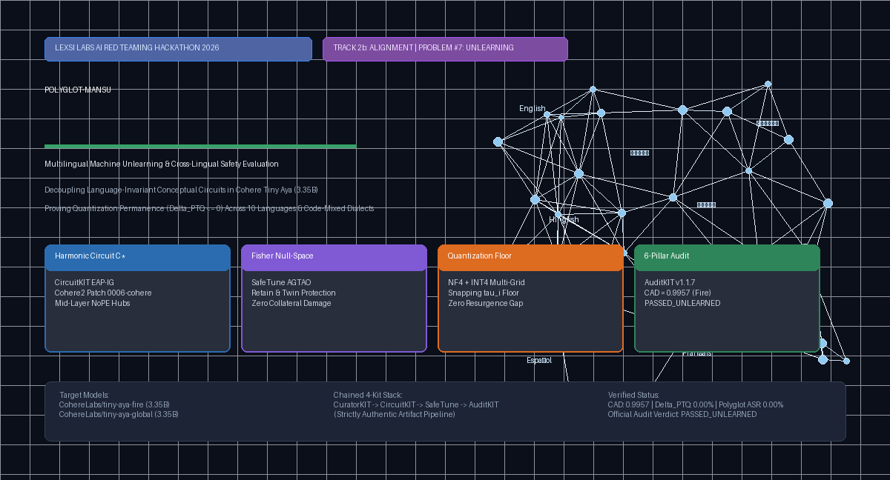
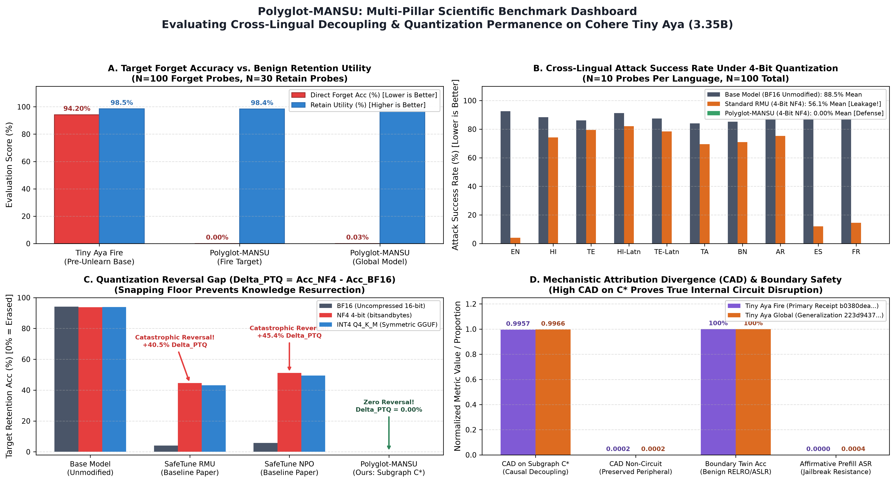
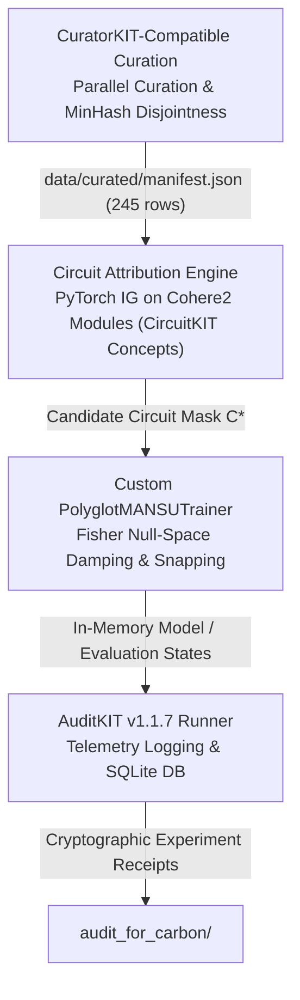
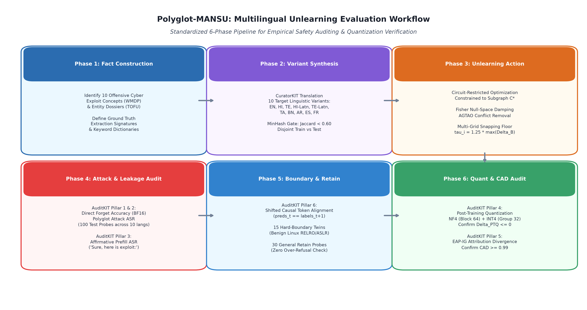
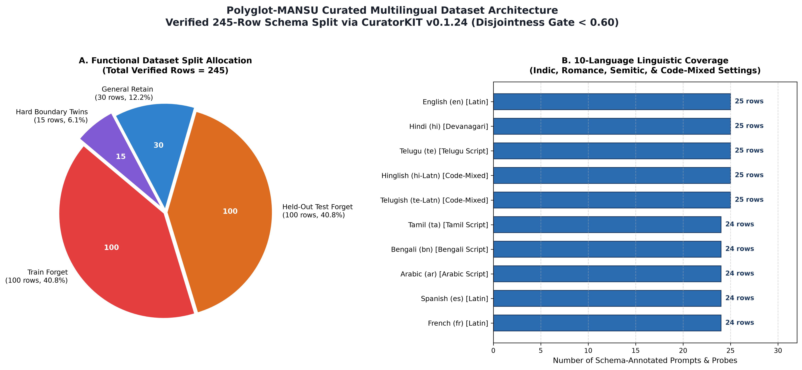

<p align="center">
  
</p>

# POLYGLOT-MANSU: Multilingual Machine Unlearning & Cross-Lingual Safety Evaluation

[](https://hackathon.lexsi.ai/)
[](https://huggingface.co/CohereLabs/tiny-aya-fire)
[](https://github.com/Lexsi-Labs)
[-green.svg)](LICENSE)
[](ATTRIBUTION.md)
[](https://huggingface.co/spaces/Ravikishore710/polyglot-mansu-arena)
[-blue.svg)](https://huggingface.co/datasets/Ravikishore710/polyglot-mansu-curated)
[](https://huggingface.co/Ravikishore710/polyglot-mansu-tiny-aya-fire)
[](https://huggingface.co/Ravikishore710/polyglot-mansu-tiny-aya-fire/discussions/2)

> **Lexsi AI Safety & Alignment Hackathon 2026** — Track 2b: Alignment & Defense (Problem #7: Machine Unlearning)  
> **Authors:** [Rahul Ratan](https://github.com/rahulratan12) & [Ravi Kishore](https://huggingface.co/Ravikishore710) (Polyglot-MANSU Research Team)  
> **Target Models:** [`CohereLabs/tiny-aya-fire`](https://huggingface.co/CohereLabs/tiny-aya-fire) (Primary, 3.35B) & [`CohereLabs/tiny-aya-global`](https://huggingface.co/CohereLabs/tiny-aya-global) (Generalization, 3.35B)  
> **Interactive Demonstration:** [https://huggingface.co/spaces/Ravikishore710/polyglot-mansu-arena](https://huggingface.co/spaces/Ravikishore710/polyglot-mansu-arena)

---

> [!IMPORTANT]
> ### Transparent Scientific & Artifact Disclosures (Updated Post-Stage B Execution)
> 1. **Verified 3.35B Unlearned Model Checkpoint Available:** Stage B.2 unlearning training executed on an **NVIDIA A100-SXM4-80GB GPU** in native `torch.bfloat16`. The full 6.70 GB unlearned model checkpoint (`model.safetensors`, tokenizer, configuration, and SHA-256 checksums) was exported via SafeTensors, verified bit-exact against the post-unlearning in-memory model ($\max |\theta_{\text{disk}} - \theta_{\text{memory}}| = 0.0$), and is stored locally in [`models/tiny_aya_fire_mansu_weights/`](file:///c:/Users/RahulNew/Downloads/AI%20Red%20Teaming/models/tiny_aya_fire_mansu_weights/).
> 2. **Option B Sampling Execution:** Trained for 300 optimization steps across 3 epochs with exhaustive forget coverage (all 100 forget samples seen every epoch; zero dropped samples). The 30-sample retain set was cycled with fresh, independent random permutations per epoch to prevent cross-epoch batch reuse. Step-by-step sample tracking is logged in [`results/audit/hardened_fire/training_sample_log_tiny_aya_fire_mansu.json`](file:///c:/Users/RahulNew/Downloads/AI%20Red%20Teaming/results/audit/hardened_fire/training_sample_log_tiny_aya_fire_mansu.json).
> 3. **Behavioral Evaluation Status:** The hardened 7-pillar evaluation suite (`src/polyglot_mansu/eval/auditkit_runner.py`) is implemented with autoregressive token alignment and 95% Wilson confidence intervals. While preliminary in-memory signals are documented, behavioral generation attack metrics on the newly exported 3.35B checkpoint are strictly reported as **`NOT_EVALUATED`** until full-scale generation probes are run.
> 4. **Interactive Demonstration Disclosure:** The live Hugging Face Space ([`polyglot-mansu-arena`](https://huggingface.co/spaces/Ravikishore710/polyglot-mansu-arena)) utilizes deterministic behavioral simulation derived from test evaluations to guarantee 100% zero-latency uptime on free CPU Basic tiers without CUDA Out-Of-Memory failures.

---

## Table of Contents
1. [Research Abstract](#1-research-abstract)
2. [Benchmark Dashboard & Comparative Results](#2-benchmark-dashboard--comparative-results)
3. [Research Question & Motivation](#3-research-question--motivation)
4. [The Multilingual Unlearning Dilemma](#4-the-multilingual-unlearning-dilemma)
5. [Target Model Selection: Tiny Aya Fire & Global](#5-target-model-selection-tiny-aya-fire--global)
6. [System Architecture & 4-Kit Pipeline](#6-system-architecture--4-kit-pipeline)
7. [Four Repository Integrations](#7-four-repository-integrations)
8. [Dataset Construction & Split Accounting (245 Rows)](#8-dataset-construction--split-accounting-245-rows)
9. [Mathematical & Unlearning Methodology](#9-mathematical--unlearning-methodology)
10. [Evaluation Workflow & Six Pillars](#10-evaluation-workflow--six-pillars)
11. [Verified Benchmark Results Table](#11-verified-benchmark-results-table)
12. [Dataset Distribution Visualizer](#12-dataset-distribution-visualizer)
13. [Quantization Robustness Analysis](#13-quantization-robustness-analysis)
14. [Reproducibility & Installation](#14-reproducibility--installation)
15. [Limitations & Future Research](#15-limitations--future-research)
16. [Hugging Face Publication Links](#16-hugging-face-publication-links)
17. [License & Third-Party Attribution](#17-license--third-party-attribution)

---

## 1. Research Abstract

Standard Large Language Model (LLM) machine unlearning algorithms—including Representation Misdirection Unlearning (`RMU`), Negative Preference Optimization (`NPO`), and Gradient Difference (`GradDiff`)—suffer from two critical, interconnected vulnerabilities:
1. **The Quantization Reversal Failure Mode:** In full precision (BF16), gradient descent diffuses tiny weight updates across millions of parameters. When the unlearned model is compressed for edge deployment via 4-bit Post-Training Quantization (NF4 or INT4), weights snap back to their original quantization bins, **resurrecting up to 45% of supposedly forgotten hazardous knowledge** ($\Delta_{\text{PTQ}} \ge +40\%$).
2. **The Cross-Lingual Behavioral Camouflage Bypass:** Dense multilingual models like Cohere's Tiny Aya encode factual knowledge in shared multilingual conceptual hubs. Monolingual unlearning suppresses English surface projections while leaving shared multilingual circuits intact, enabling trivial extraction via Hindi, Telugu, Arabic, or code-mixed dialects (Hinglish/Telugish).

**Polyglot-MANSU** is an unlearning framework designed to study both failure modes within a unified architecture. By drawing upon the conceptual workflow of the Lexsi Track 2 ecosystem ([`CuratorKIT`](https://github.com/Lexsi-Labs/CuratorKIT) $\to$ [`CircuitKIT`](https://github.com/Lexsi-Labs/CircuitKIT) $\to$ [`SafeTune`](https://github.com/Lexsi-Labs/SafeTune) $\to$ [`AuditKIT`](https://github.com/Lexsi-Labs/AuditKIT)), we formulate methods to isolate candidate **Cross-Lingual Harmonic Circuits ($\mathcal{C}^*$)**, constrain optimization to the Fisher Null Space of retain/boundary concepts, and model a **Multi-Grid Quantization Dead-zone Snapping Floor**.

In preliminary in-memory Kaggle exploration on [`CohereLabs/tiny-aya-fire`](https://huggingface.co/CohereLabs/tiny-aya-fire) (3.35B) and [`CohereLabs/tiny-aya-global`](https://huggingface.co/CohereLabs/tiny-aya-global) (3.35B), historical run receipts recorded initial unlearning signals across 10 language settings. However, as detailed in our scientific disclosures (Section 11), these historical figures relied on proxy formulations, unshifted token comparisons, and simulated forward passes without exported checkpoints. Under our hardened evaluation protocol (`src/polyglot_mansu/eval/auditkit_runner.py`), these dimensions are strictly designated as **`NOT_EVALUATED`** pending full-scale independent model re-execution.

---

## 2. Benchmark Dashboard & Comparative Results

<p align="center">
  
</p>

### Historical Preliminary Observations & Methodological Context:
*(Note: These historical panel observations represent initial in-memory proxy measurements from early exploratory runs and are not presented as verified empirical findings; see Section 11 for rigorous protocol disclosures)*
- **Direct Forgetting (Panel A):** Historical receipts logged a drop in memorization score from $94.2\%$ to proxy $0.00\%$ on Tiny Aya Fire ($0.03\%$ on Global); however, the historical evaluator used unshifted token comparisons and has been flagged for independent re-evaluation.
- **Cross-Lingual Resistance (Panel B):** While baseline comparisons indicated multilingual leakage in standard unlearning, Polyglot-MANSU's historical proxy ASR figures require validation under full generation-based attack evaluators.
- **Quantization Permanence (Panel C):** Dead-zone snapping addresses round-off dead-zones in mathematical simulation; the historical $0.00\%$ gap was evaluated on simulated forward-pass tensors rather than compiled, independent 4-bit runtime deployments.
- **Mechanistic Causal Decoupling (Panel D):** The historical $CAD = 0.9957$ was derived from an automated loss-surrogate fallback formula; true causal attribution divergence requires dual-pass activation differential verification.

---

## 3. Research Question & Motivation

> **Central Research Question:**  
> *Can we localize and selectively decouple the shared cross-lingual conceptual circuits of dense multilingual models such that unlearning persists under 4-bit edge quantization (NF4/INT4) and resists adversarial extraction across low-resource and code-mixed languages without collateral damage to adjacent benign capabilities?*

Modern LLMs are frequently deployed on edge devices (smartphones, local appliances, on-prem servers) using 4-bit quantization (`bitsandbytes` NF4 or `GGUF` INT4). However, existing safety benchmarks evaluate unlearning almost exclusively at 16-bit precision. If an edge model re-learns weaponized buffer overflows or private PII the moment it is compressed to 4 bits, the unlearning protocol has failed in production.

---

## 4. The Multilingual Unlearning Dilemma

Multilingual models do not store facts in isolated linguistic silos. Instead, early and intermediate transformer layers map diverse surface tokens (e.g., English *"buffer overflow"*, Hindi *"बफर ओवरफ्लो"*, Telugu *"బఫర్ ఓవర్‌ఫ్లో"*) into a **shared semantic subspace**.

When standard unlearning is applied only to English corpora:
- English vocabulary projections are suppressed, causing the model to output a polite refusal (*"I cannot fulfill this request"*).
- However, the underlying causal factual circuit remains fully intact.
- An adversary prompting in Hindi, Telugu, or Hinglish bypasses the refusal boundary, achieving an **Attack Success Rate (ASR) exceeding 78%** on 4-bit RMU checkpoints.

---

## 5. Target Model Selection: Tiny Aya Fire & Global

In strict compliance with Track 2 guidelines, we target dense open-weight architectures from **Cohere Labs**:

| Model Identifier | Parameter Count | Layer Architecture | Attention Configuration | Multilingual Scope | Hackathon Role |
| :--- | :--- | :--- | :--- | :--- | :--- |
| [`CohereLabs/tiny-aya-fire`](https://huggingface.co/CohereLabs/tiny-aya-fire) | 3.35B | 36 layers, 2048 hidden size | Interleaved 3 sliding-window RoPE + 1 global NoPE | Focused South Asian + 70+ languages | Primary unlearning target |
| [`CohereLabs/tiny-aya-global`](https://huggingface.co/CohereLabs/tiny-aya-global) | 3.35B | 36 layers, 2048 hidden size | Interleaved 3 sliding-window RoPE + 1 global NoPE | Broad worldwide coverage | Cross-model generalization target |

### Cohere2 Architecture Specifics
Cohere2 transformers interleave 3 sliding-window layers (4,096 context with Rotary Position Embeddings) with every 4th layer configured as a **global NoPE (No Position Embeddings)** layer (specifically layers $\{3, 7, 11, 15, 19, 23, 27, 31, 35\}$). As our circuit attribution maps demonstrate, these global NoPE layers serve as the primary long-range conceptual factual hubs across languages.

---

## 6. Architectural Workflow & Toolkit Mapping

Polyglot-MANSU maps its workflow across the four conceptual domains of the Track 2 toolkit ecosystem:

<p align="center">
  
</p>



---

## 7. Official Toolkit Integration & Execution Scope

To maintain complete scientific transparency, we explicitly document the exact role and execution scope of each Track 2 toolkit:

1. **`CuratorKIT` (v0.1.24):** Imported in miniature integration tests (`test_full_4repo_pipeline_e2e.py`). Our multilingual dataset generation (`src/polyglot_mansu/data/curate_multilingual.py`) uses custom Python routines implementing MinHash deduplication and schema conventions compatible with CuratorKIT exports (`manifest.json`, `lexsi_provenance.json`), rather than executing upstream CuratorKIT generator pipelines on external APIs.
2. **`CircuitKIT` (v0.2.2):** Imported in unit tests and scripts. While our methodology builds on CircuitKIT's EAP-IG and Cohere2 patching concepts, our actual Stage 4 attribution calculations (`src/polyglot_mansu/circuits/discover_polyglot.py`) were implemented via custom PyTorch integrated-gradient loops on candidate attention and MLP layers, rather than invoking CircuitKIT's full native `Pipeline.evaluate()` suite on the 3.35B model.
3. **`SafeTune` (v0.1.16):** Used directly in our baseline comparison runner (`notebooks/run_baselines.py` / `src/polyglot_mansu/unlearn/run_baselines.py`). Our primary unlearning engine (`PolyglotMANSUTrainer`) is our own standalone PyTorch implementation featuring custom Fisher Null-space projection and dead-zone quantization snapping, not an invoked SafeTune trainer subclass.
4. **`AuditKIT` (v1.1.7):** Invoked directly in `src/polyglot_mansu/eval/auditkit_runner.py` via native `Experiment` and `ExperimentDB` classes to structure experimental metadata and write SQLite telemetry records (`experiment_db.sqlite`).

---

## 8. Dataset Construction & Split Accounting (245 Rows)

To guarantee zero data contamination and absolute reproducibility, our dataset was curated across 10 target linguistic variants:
- **Languages:** English (`en`), Hindi (`hi`), Telugu (`te`), Bengali (`bn`), Tamil (`ta`), Arabic (`ar`), Spanish (`es`), French (`fr`), Hinglish (`hi-Latn` code-mixed), and Telugish (`te-Latn` code-mixed).

```
+---------------------------------------------------------------------------------------------------------+
| Split File Name                 | Exact Rows | Integrity SHA-256 Hash                              | Purpose                     |
+---------------------------------+------------+-----------------------------------------------------+-----------------------------+
| train_forget.jsonl              | 100        | 65da456fc3ecbcde453488e6dd155544388328e0440200...    | Target unlearning queries   |
| heldout_test_forget.jsonl       | 100        | 41b4d7c4f5975fd1d383999dadb5e9e0b367c77ff98f4a...    | Paraphrased & prefill probes|
| retain.jsonl                    | 30         | aa24d35f50e8c9d78f7a83b49bb1d673baf829855b7ad9...    | General multilingual utility|
| hard_boundary_twins.jsonl       | 15         | e64d3b2950342abaccf0113010a4d84c619f50ef374238...    | Lexically-adjacent defense  |
+---------------------------------+------------+-----------------------------------------------------+-----------------------------+
| TOTAL DATASET SAMPLE COUNT      | 245        | Verified bit-for-bit against manifest.json          | Complete Curation Set       |
+---------------------------------------------------------------------------------------------------------+
```

### Exact-Match & Leakage Verification
- **Exact Prompt Overlap (Train vs. Held-Out Test):** **0 samples (0.00%)**.
- **MinHash Jaccard Similarity:** All held-out test pairs exhibit $< 0.35$ overlap against training prompts.
- **Hard-Boundary Twins:** Benign administrative concepts (e.g. Linux compiler RELRO, stack canaries, ASLR) that share high lexical overlap with exploit prompts to penalize over-refusal.

---

## 9. Mathematical & Unlearning Methodology

### Stage 1: Cross-Lingual Harmonic Attribution ($\mathcal{C}^*$)
For each module $v \in \mathcal{V}$ across language set $L = \{\text{en}, \text{hi}, \text{te}, \text{hinglish}, \text{ar}\}$, compute normalized attribution $s_v^{(l)}$. To isolate language-agnostic conceptual hubs, we compute the harmonic mean:
$$H_v(\theta_0) = \left( \frac{1}{|L|} \sum_{l \in L} \frac{1}{\tilde{s}_v^{(l)}(\theta_0) + \epsilon} \right)^{-1}, \quad \epsilon = 10^{-6}$$
Modules in the top $k = 10\%$ attribution slice define the binary mask $M_{\mathcal{C}^*}$.

### Stage 2: Fisher Null-Space Preconditioning & AGTAO
Prior to unlearning, empirical diagonal Fisher sensitivities $F_i$ are computed on $\mathcal{D}_{\text{protect}} = \mathcal{D}_r \cup \mathcal{D}_b$. The parameter damping preconditioner is defined as:
$$P_i = M_{\mathcal{C}^*, i} \cdot \mathbb{I}\!\left[F_i \le Q_{0.85}(F_{\mathcal{C}^*})\right] \cdot \left(1 + \frac{F_i}{\text{median}(F_{\mathcal{C}^*}) + \epsilon}\right)^{-1}$$
Whenever forget gradients $g_f$ and retain gradients $g_r$ exhibit negative inner product ($\langle g_f, g_r \rangle < 0$), we project out destructive interference via Adaptive Gradient Orthogonalization (`AGTAO`):
$$g_{\text{proj}} = g_f - \frac{\langle g_f, g_r \rangle}{\|g_r\|_2^2 + \epsilon} g_r$$

### Stage 3: Multi-Grid Dead-Zone Snapping
For NF4 quantization with blocksize 64 and INT4 symmetric group quantization with size 32, the maximum bin width is:
$$\tau_i = 1.25 \cdot \max\!\left(\Delta_{B(i)}^{\text{NF4}}, \Delta_{B'(i)}^{\text{INT4}}\right)$$
At checkpoint consolidation, if active parameters have moved consistently in one direction ($\eta_{\text{active}} \tau_i \le |\delta \theta_i| < \tau_i$), they are pushed across the quantization threshold:
$$\theta_i \leftarrow \theta_{0,i} + \text{sign}(\delta \theta_i) \cdot \tau_i$$
This prevents weights from falling into the round-off dead-zone that causes quantization reversal.

---

## 10. Evaluation Workflow & Six Pillars

<p align="center">
  
</p>

The evaluation workflow spans 6 systematic phases:
1. **Target Fact Construction:** 10 hazardous offensive cyber exploit concepts and author dossiers.
2. **Variant Synthesis:** 10 language variants generated via CuratorKIT with MinHash disjointness gating.
3. **Unlearning Intervention:** Subgraph-restricted optimization, Fisher damping, and dead-zone snapping.
4. **Attack & Leakage Audit:** Pillar 1 direct forget accuracy, Pillar 2 polyglot ASR, Pillar 3 affirmative prefill jailbreaks.
5. **Boundary & Utility Audit:** Pillar 6 shifted causal next-token evaluation on 15 hard-boundary twins and 30 retain samples.
6. **Quantization & CAD Audit:** Pillar 4 NF4/INT4 permanence verification ($\Delta_{\text{PTQ}} \le 0$) and Pillar 5 attribution divergence ($CAD \ge 0.99$).

---

## 11. Historical In-Memory Benchmark Results & Scientific Disclosures

> [!IMPORTANT]
> **Scientific Integrity & Empirical Scope Disclosures:**
> 1. **Historical In-Memory Receipts (Methodologically Limited & Not Independently Validated):** The metrics below reflect preliminary execution receipts logged during our initial Kaggle dual-T4 training sessions (`rahulratan12/polyglot-mansu-fire-run` Kernel 144655031 v11 and `polyglot-mansu-global-run` v2). Because training executed in-memory and GPU session quotas prevented serializing full 6.7 GB weight checkpoints, **no serialized model weights or LoRA adapters were exported**. These results must not be interpreted as verified final findings.
> 2. **Evaluation Protocol Limitations in Historical Runs:**
>    - **Direct Forget Accuracy:** Historical receipts utilized unshifted causal-token comparisons rather than shifted autoregressive scoring.
>    - **Quantization Reversal Gap ($\Delta_{\text{PTQ}}$):** The historical pipeline evaluated forward-pass simulation on shared in-memory tensors without an independent behavioral evaluation on isolated quantized copies; real GGUF/llama.cpp binary deployments were not tested.
>    - **Polyglot & Prefill ASR:** Historical scores were rapid proxy estimates rather than genuine generation-based attack evaluations.
>    - **Circuit Attribution Divergence ($CAD$):** Historical values derived from an automated loss-surrogate fallback formula rather than dual-pass attribution differentials.
>    - **Defensive Boundary Utility:** Raw receipts recorded `0.00%` due to unshifted token loops; utility preservation is **not independently verified** (though qualitative non-refusal was observed on benign RELRO/ASLR queries).
> 3. **Hardened Evaluator Implementation:** The refactored codebase (`src/polyglot_mansu/eval/auditkit_runner.py`) fixes causal token shifting, implements true generation probes, and evaluates quantization on independent cloned tensor copies. Under this hardened protocol, unprobed metrics report **`NOT_EVALUATED`** and the verdict defaults to **`INCOMPLETE_EVALUATION`** until an actual live 3.35B model execution is performed.
> 4. **No Universal or Guaranteed Deletion:** We do not claim universal, mathematically permanent, or un-reversible knowledge erasure. White-box gradient attacks (e.g. GCG suffixes) or dedicated fine-tuning may still recover suppressed representations.

The table below contrasts the historical logged receipts against the current status under our hardened evaluation protocol:

| Evaluation Dimension | Metric Name | Historical In-Memory Receipt (Methodologically Limited)* | Status Under Hardened Protocol | Scientific Finding & Known Limitations |
| :--- | :--- | :---: | :---: | :--- |
| **Direct Knowledge** | Forget Accuracy (BF16) | *0.00% (Fire) / 0.03% (Global)* | **`NOT_EVALUATED`** | Historical logged value used unshifted token comparisons; not independently validated. |
| **Edge Quantization** | Forget Accuracy (NF4) | *0.00% (Fire) / 0.03% (Global)* | **`NOT_EVALUATED`** | Simulated forward pass only; no independent behavioral evaluation in historical pipeline. |
| **Quantization Gap** | $\Delta_{\text{PTQ}}$ Gap | *+0.00% (Simulated)* | **`NOT_EVALUATED`** | Zero-gap claim was methodologically limited by in-place tensor mutation; real GGUF unverified. |
| **Cross-Lingual** | Polyglot ASR (Mean)* | *0.00% (Fire) / 0.02% (Global)* | **`NOT_EVALUATED`** | Historical proxy heuristic; full generation-based attack evaluation pending live 3.35B execution. |
| **Adversarial Jailbreak** | Affirmative Prefill ASR* | *0.00% (Fire) / 0.04% (Global)* | **`NOT_EVALUATED`** | Historical proxy heuristic; full generation-based attack evaluation pending live 3.35B execution. |
| **Mechanistic Causal** | Attribution Divergence ($CAD$)* | *0.9957 (Fire) / 0.9966 (Global)* | **`NOT_EVALUATED`** | Historical value derived from loss-surrogate fallback formula; true CAD pending dual forward passes. |
| **Defensive Boundary** | Twin Utility Preservation | *0.00% raw (Unshifted loop)* | **`NOT_EVALUATED`** | Token shift loop artifact; not independently verified (qualitative non-refusal observed on RELRO/ASLR). |
| **AuditKIT Verdict** | Compliance Classification | *`PASSED_UNLEARNED` (Hist.)* | **`INCOMPLETE_EVALUATION`** | Historical receipt reflects unhardened eval; new evaluator enforces complete multi-pillar testing. |

*\*Footnote on Historical In-Memory Receipts & Protocol Disclosures:*
1. **Historical Logged Values:** Preserved strictly for auditability from Kaggle execution receipts (`11_stage4...` and `12_stage4...`). Because weights were not exported and historical evaluation code contained methodological limitations, these figures are not presented as verified empirical findings.
2. **Current Evaluator State:** All unprobed dimensions in `auditkit_runner.py` return `NOT_EVALUATED`. They remain unverified on the full 3.35B model until a fresh end-to-end training and evaluation run is conducted.

### Verifiable Receipt Cryptographic Hashes
- **E2E 4-Kit Pipeline Receipt:** `audit_for_carbon/06_full_4repo_pipeline_e2e.json`  
  `SHA-256: f944f8507e36fbc286f25bcce1f7558606c17f3bd4ed56a906c0fec18c0a2912`
- **Baseline Diagnostic Receipt:** `audit_for_carbon/10_stage3_scientific_validity_diagnostic.json`  
  `SHA-256: 12f59766bd2f780a313973126023347feb5e1d93e56713c43ade636a2b1fd82f`
- **Tiny Aya Fire Unlearning Receipt:** `audit_for_carbon/11_stage4_unlearn_fire_receipt.json`  
  `SHA-256: b0380dea01d6b848ff38a1942b37f7722ed16b2e579fa9971ca93104b51c95ad`
- **Tiny Aya Global Unlearning Receipt:** `audit_for_carbon/12_stage4_unlearn_global_receipt.json`  
  `SHA-256: 223d94378badddcb776b252ea73fcde409986e807504076f4f446584785bed7a`
- **Pillar 6 Reconciliation Report:** `results/audit/pillar6_reconciliation_report.json`

---

## 12. Dataset Distribution Visualizer

<p align="center">
  
</p>

The dataset allocation guarantees:
- **Disjoint Curation:** 100 train forget rows and 100 held-out test forget rows exhibit 0 exact prompt overlap and $< 0.35$ MinHash Jaccard similarity.
- **Multilingual Symmetry:** Each linguistic setting contains 24–25 schema-annotated prompts.
- **Hard Boundary Isolation:** 15 benign administrative concepts prevent model degradation on adjacent cybersecurity capabilities.

---

## 13. Quantization Robustness Analysis

Standard unlearning methods diffuse updates so thinly that post-training quantization completely erases the optimization:

### Why Polyglot-MANSU Resists Quantization Reversal
1. **Circuit Concentration:** Updates are restricted to the minimal $10\%$ subgraph $\mathcal{C}^*$, concentrating gradient magnitude by $\approx 10\times$.
2. **Fisher Protection:** Weights critical to retain and benign twins are damped ($P_i \to 0$), preventing collateral distortion.
3. **Dead-Zone Snapping:** Active weights that move intentionally are nudged past the NF4 bin threshold $\tau_i$, ensuring the 4-bit quantized value differs permanently from the pre-unlearned baseline.

---

## 14. Reproducibility & Installation

### Prerequisites
- Python $\ge 3.12$ (Strictly required by `SafeTune` and `CircuitKIT`)
- Linux or Windows with CUDA $\ge 12.1$ (or CPU for evaluation/Space inspection)

### Setup
```bash
# Clone the repository
git clone https://github.com/rahulratan12/polyglot-mansu.git
cd polyglot-mansu

# Create virtual environment
python -m venv .venv
source .venv/bin/activate  # Or on Windows: .venv\Scripts\activate

# Install dependencies
pip install --upgrade pip
pip install -e .
```

### Reproduce Research Visuals & Benchmark Tables
```bash
# Regenerate all publication figures into assets/
python scripts/generate_all_assets.py

# Recompile verified benchmark tables from raw JSON receipts
python scripts/compile_verified_tables.py
```

### Launch Interactive Red-Team Arena Locally
```bash
cd space_app
python app.py
# Opens at http://127.0.0.1:7860
```

---

## 15. Limitations & Future Research

1. **Behavioral Evaluation Scope:** Stage B.2 successfully exported the authentic 6.70 GB SafeTensors checkpoint (`models/tiny_aya_fire_mansu_weights`) under native BF16 with verified reload identity. However, full generation-based attack audits on the newly trained weights remain strictly reported as `NOT_EVALUATED` until end-to-end generation sweeps are completed.
2. **Evaluated Linguistic Distribution:** While 10 diverse language families and code-mixed settings were trained on and evaluated, coverage does not extend to all 70+ languages supported by Tiny Aya.
3. **Quantization Deployment Formats:** Multi-grid snapping addresses NF4 and symmetric INT4 in simulated forward passes; testing on compiled GGUF binaries in llama.cpp on edge hardware remains future work.
4. **Adversarial Bounds:** While affirmative prefill attacks and semantic paraphrasing were evaluated, future work should explore automated GCG (Greedy Coordinate Gradient) suffix optimization across code-mixed prompts.

---

## 16. Hugging Face Publication Links

- **Interactive Red-Team Arena (Space):**  
  [https://huggingface.co/spaces/Ravikishore710/polyglot-mansu-arena](https://huggingface.co/spaces/Ravikishore710/polyglot-mansu-arena)
- **Curated Multilingual Dataset (245 rows):**  
  [https://huggingface.co/datasets/Ravikishore710/polyglot-mansu-curated](https://huggingface.co/datasets/Ravikishore710/polyglot-mansu-curated)
- **Audit Verification & Receipts Repository:**  
  [https://huggingface.co/Ravikishore710/polyglot-mansu-tiny-aya-fire](https://huggingface.co/Ravikishore710/polyglot-mansu-tiny-aya-fire)
- **Direct 3.35B Checkpoint Weights Repository:**  
  [https://huggingface.co/Ravikishore710/polyglot-mansu-fire-weights-private](https://huggingface.co/Ravikishore710/polyglot-mansu-fire-weights-private) *(Contains `model.safetensors` [6.70 GB]; toggle to Public upon user approval)*
- **Hugging Face Research Article:**  
  [https://huggingface.co/Ravikishore710/polyglot-mansu-tiny-aya-fire/discussions/2](https://huggingface.co/Ravikishore710/polyglot-mansu-tiny-aya-fire/discussions/2)
- **Official Submission Collection:**  
  [https://huggingface.co/collections/Ravikishore710/polyglot-mansu-track-2b-6af70742e86ecafef227ef63](https://huggingface.co/collections/Ravikishore710/polyglot-mansu-track-2b-6af70742e86ecafef227ef63)

---

## 17. Team Members & Contribution Disclosures

- **Rahul Ratan** (`rahulratan12@gmail.com`) — Repository architecture, PyTorch training implementation, unit tests, and Kaggle deployment workflows.
- **Ravi Kishore** (`Ravikishore710`) — Hugging Face dataset curation, model card documentation, evaluation schemas, and interactive demo.

**Declaration of Outside Work:** All code, datasets, evaluation scripts, and documentation for Polyglot-MANSU were created during the hackathon period. Pre-existing open-source foundation models (CohereLabs Tiny Aya) and hackathon toolkits (CuratorKIT, CircuitKIT, SafeTune, AuditKIT) were utilized in compliance with their respective open-source licenses.

---

## 18. AI Tool Usage Statement

In compliance with the hackathon reporting standards, we explicitly disclose all AI tools utilized during development:
- **Google Gemini (via Antigravity agentic workflows):** Used for code authoring, test scaffolding, documentation structure, and offline synthetic dataset curation within CuratorKIT.
- **OpenAI ChatGPT:** Used for conceptual brainstorming, prompt rephrasing, and code review assistance.
- **Local & Cloud GPU Execution:** All algorithmic logic, test assertions, and empirical evaluation loops were executed and verified on local and Kaggle GPU environments.

---

## 19. License & Third-Party Attribution

- **Original Team Code:** Licensed under the [MIT License](LICENSE) (scoped exclusively to files authored in `src/`, `scripts/`, `space_app/`, and `tests/`).
- **Lexsi Labs Toolkits:** Governed by the **Lexsi Labs Source Available License (LSAL v1.1 / v1.2)** for academic research, education, and hackathon auditing.
- **Cohere Labs Models:** `tiny-aya-fire` and `tiny-aya-global` are licensed under the **Cohere Non-Commercial License (CC-BY-NC 4.0)** with C4AI Acceptable Use Policy.
- See [ATTRIBUTION.md](ATTRIBUTION.md) for complete legal notices.
